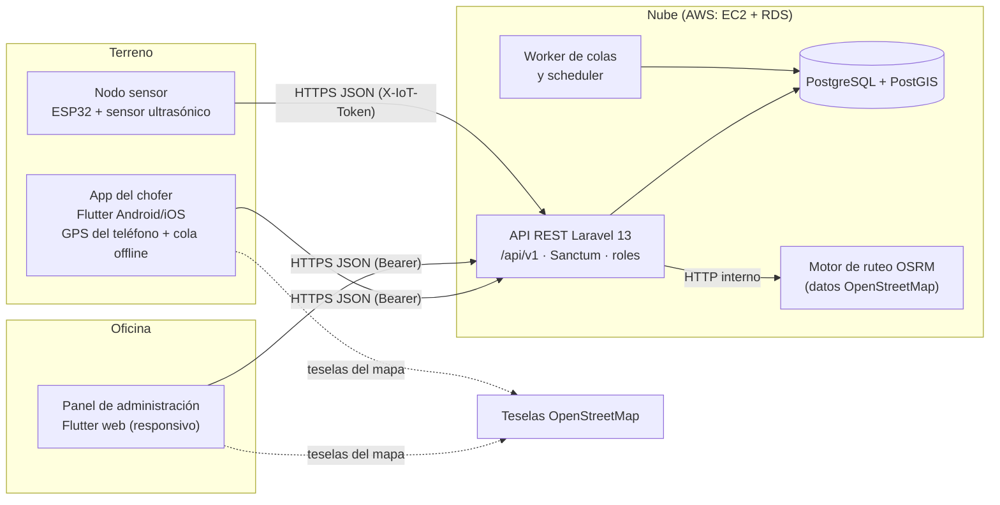

# EcoRuta Temuco — API back-end

API REST de **EcoRuta Temuco**, la plataforma de gestión logística de **Somos Terranova** para la recolección de residuos reciclables en Temuco y Padre Las Casas.

Equipo de desarrollo: Maximiliano González y Nelson Ponce.

> Repositorio hermano (cliente Flutter web + móvil): [`../logistica_camion_front_end`](../logistica_camion_front_end).

---

## 1. Objetivo del programa

Somos Terranova planifica hoy sus rutas de recolección a mano, con dos camiones arrendados y dos choferes. Los camiones visitan puntos de reciclaje con días fijos, aunque el contenedor esté vacío.

EcoRuta reemplaza ese proceso por uno basado en datos reales:

1. **Rutas según el llenado real.** Cada día se genera la hoja de ruta solo con los puntos en estado `alto` o `lleno`. El estado llega desde sensores (ESP32 + sensor ultrasónico) o lo ajusta el administrador.
2. **Rastreo de la flota en tiempo real.** La posición se obtiene del GPS del teléfono del chofer, porque los camiones son arrendados y no se les puede instalar hardware ni leer OBD2. La latencia máxima es de 30 s.
3. **Registro en terreno con o sin señal.** El chofer marca cada punto vaciado, y la app sincroniza sin duplicados al recuperar conexión.
4. **Indicadores de gestión (KPI).** Cada indicador compara un resultado con una meta, para evaluar la operación y respaldar los reportes de la Ley REP.

**Objetivo general:** optimizar la recolección de residuos reciclables de Somos Terranova mediante rutas generadas a partir del estado real de llenado, rastreo de flota en tiempo real e indicadores confiables.

**SLA comprometidos:** posición GPS ≤ 30 s · cambio de estado de un punto ≤ 5 min · generación de ruta ≤ 2 min · P95 de la API ≤ 800 ms · disponibilidad 95 % (lun–sáb 07:00–19:00) · RTO 4 h · RPO 5 min.

## 2. Estado actual

| Módulo | Estado |
|---|---|
| Autenticación con tokens (Sanctum), roles, auditoría de accesos | ✅ Implementado |
| CRUD de camiones y choferes (datos personales cifrados) | ✅ Implementado |
| Sectores (los 12 reales) y puntos de reciclaje: API, zona de operación y vigencia del estado (ADR-0013) | ✅ Implementado (BE-03) |
| Importación de los puntos reales, sensores IoT, telemetría | ⏳ Pendiente (BE-04 a BE-06) |
| GPS en vivo, administración de GPS, consumo de comunicaciones | ⏳ Pendiente (BE-07 a BE-09) |
| Motor de rutas y ciclo de vida de la ruta | ⏳ Pendiente (BE-10, BE-11) |
| Validación de licencias de conducir | ⏳ Pendiente (BE-12) |
| KPI con metas, alertas y exportación | ⏳ Pendiente (BE-13, BE-14) |
| Firmware del nodo sensor (`iot-esp32/`) | ⏳ Pendiente (IOT-01) |

El detalle y el orden de trabajo están en [`tasks/README.md`](tasks/README.md), el índice general de tareas de ambos repositorios.

## 3. Arquitectura del sistema



- **Clientes:** una sola base de código Flutter. El rol `administrador` usa el panel (web o móvil) y el rol `chofer` la app móvil.
- **API:** Laravel 13 sobre PHP 8.5 (Laravel Sail en desarrollo y Docker + Nginx en AWS EC2). Es el único punto de entrada; ningún cliente se conecta a la base de datos.
- **Persistencia:** PostgreSQL con PostGIS para las consultas geoespaciales y el modo degradado de ruteo.
- **Ruteo y mapas:** OpenStreetMap con OSRM autoalojado. Reemplaza a Google Maps Platform por ser gratuito y sin cuota ([ADR-0005](docs/ADR/0005-openstreetmap-y-osrm-en-lugar-de-google-maps.md), propuesta).
- **Tiempo real:** polling HTTP cada 10–15 s ([ADR-0011](docs/ADR/0011-tiempo-real-por-polling-http.md)).

El detalle (componentes, flujos, despliegue y cambios respecto del diseño inicial) está en [`docs/ARCHITECTURE.md`](docs/ARCHITECTURE.md).

## 4. Estructura del repositorio

```text
logistica-camion-back-end/
├── AGENTS.md                 # Reglas para agentes de IA (Claude Code, OpenCode, etc.)
├── CLAUDE.md                 # Hace que Claude Code cargue AGENTS.md
├── README.md                 # Este archivo
├── .env.example              # Variables de entorno (sin secretos)
├── app/
│   ├── Http/
│   │   ├── Controllers/Api/V1/   # Controladores REST versionados
│   │   ├── Middleware/           # role:<rol>, active
│   │   ├── Requests/             # Validación (FormRequest) por recurso
│   │   └── Resources/            # Serialización JSON (JsonResource)
│   ├── Models/               # Eloquent: User, Administrador, Chofer, Camion, AuditLog
│   ├── Services/             # (pendiente) motor de rutas, telemetría, KPI
│   └── Providers/
├── config/                   # Configuración de Laravel (+ kpis.php, ruteo.php pendientes)
├── database/
│   ├── migrations/           # Esquema versionado
│   ├── factories/            # Datos para pruebas
│   └── seeders/              # Datos de desarrollo y demostración
├── docs/
│   ├── API.md                # Contrato de la API (implementado y pendiente)
│   ├── ARCHITECTURE.md       # Arquitectura, flujos y despliegue
│   ├── DATA_MODEL.md         # Modelo de datos actual y objetivo
│   ├── ROADMAP.md            # Plan hasta la entrega final y después
│   ├── SECURITY.md           # Controles, brechas conocidas y checklist
│   └── ADR/                  # Decisiones de arquitectura (una por archivo)
├── iot-esp32/                # (pendiente, IOT-01) firmware PlatformIO del nodo sensor
├── routes/api.php            # Rutas /api/v1
├── tasks/                    # Tareas de desarrollo + índice general (BE, FE, IOT, DOC)
├── tests/Feature/            # Pruebas Pest de la API
├── compose.yaml              # Servicios de Sail (app + PostgreSQL/PostGIS)
└── .github/workflows/        # CI (lint, tipos, pruebas)
```

## 5. Puesta en marcha (desarrollo)

Requisitos: Docker y Docker Compose. PHP y Composer en el equipo son opcionales.

```bash
cp .env.example .env
```

Antes de sembrar la base, elige en `.env` el ambiente y completa sus credenciales. Si falta alguna, el seeder se detiene con un mensaje que la nombra.

| Ambiente | `APP_DEMO_MODE` | Variables obligatorias | Qué crea `migrate --seed` |
|---|---|---|---|
| Empresa (por defecto) | `false` | `ADMIN_EMAIL`, `ADMIN_PASSWORD` (opcional `ADMIN_NOMBRE`) | La cuenta de administrador y los 12 sectores reales de recolección (`SectorSeeder`). No crea puntos, camiones ni choferes |
| Demostración | `true` | `DEMO_ADMIN_EMAIL`, `DEMO_ADMIN_PASSWORD`, `DEMO_CHOFER_PASSWORD` | Un administrador y 2 choferes de demostración, 3 camiones, los 12 sectores reales y 16 puntos de prueba asignados a esos sectores |

Si no tienes PHP local, instala las dependencias con el contenedor de Sail:

```bash
docker run --rm -u "$(id -u):$(id -g)" -v "$(pwd):/var/www/html" -w /var/www/html laravelsail/php84-composer:latest composer install --ignore-platform-reqs
```

```bash
vendor/bin/sail up -d
```

```bash
vendor/bin/sail artisan key:generate
```

```bash
vendor/bin/sail artisan migrate --seed
```

Solo en modo demostración, para que los KPI tengan datos, genera un historial de rutas:

```bash
vendor/bin/sail artisan ecoruta:generar-historial --meses=3
```

La API queda en `http://localhost` (puerto `APP_PORT`) y responde `{"status":"ok"}` en `/`. Las credenciales para entrar son las que definiste en `.env`. Para desplegar la demo en Neon, Render y Netlify, sigue [`docs/DESPLIEGUE_DEMO.md`](docs/DESPLIEGUE_DEMO.md).

### Actualizar un entorno ya levantado

Después de `git pull`, instala las dependencias nuevas (si cambió `composer.lock`), aplica las migraciones y vuelve a cargar los sectores:

```bash
vendor/bin/sail composer install
```

```bash
vendor/bin/sail artisan migrate
```

```bash
vendor/bin/sail artisan db:seed --class=SectorSeeder
```

`SectorSeeder` es repetible: crea o actualiza los 12 sectores por nombre y no toca los puntos. En modo demostración, `vendor/bin/sail artisan db:seed --class=DemoSeeder` también reasigna los puntos de prueba a los sectores reales. No uses `migrate:fresh` si quieres conservar los datos.

> **Puntos creados antes de BE-03:** la migración reemplaza la antigua columna de texto `puntos.sector` (5 sectores inventados) por `sector_id`. Los puntos que ya existían quedan sin sector y marcados para revisión (`requiere_revision = true`) hasta que se les asigne uno.

> **Si ya tenías el entorno levantado antes de PostGIS:** recrea el contenedor de la base con `vendor/bin/sail up -d --force-recreate pgsql` y ejecuta `vendor/bin/sail artisan migrate`. El volumen de datos se conserva (la imagen sigue siendo Alpine y PostgreSQL 18). La imagen `postgis/postgis` solo se publica para amd64; en equipos ARM corre emulada.

## 6. Comandos frecuentes

| Acción | Comando |
|---|---|
| Ejecutar pruebas | `vendor/bin/sail artisan test --compact` |
| Una prueba | `vendor/bin/sail artisan test --compact --filter=NombreDeLaPrueba` |
| Formatear PHP | `vendor/bin/sail bin pint --dirty` |
| Análisis estático | `vendor/bin/sail composer types:check` |
| Lint + tipos + pruebas (CI) | `vendor/bin/sail composer ci:check` |
| Ver rutas de la API | `vendor/bin/sail artisan route:list --path=api` |

## 7. Documentación

- [Contrato de la API](docs/API.md)
- [Arquitectura](docs/ARCHITECTURE.md)
- [Modelo de datos](docs/DATA_MODEL.md)
- [Hoja de ruta](docs/ROADMAP.md)
- [Seguridad](docs/SECURITY.md)
- [Decisiones de arquitectura (ADR)](docs/ADR/README.md)
- [Índice general de tareas](tasks/README.md)

## 8. Desarrollo con agentes de IA

El repositorio está preparado para trabajar con Claude Code, OpenCode u otros agentes:

1. El agente lee [`AGENTS.md`](AGENTS.md); Claude Code lo carga a través de `CLAUDE.md`.
2. Toma **una** tarea de [`tasks/`](tasks/README.md) cuyas dependencias estén cumplidas.
3. Respeta los ADR aceptados y actualiza `docs/` y el estado de la tarea al terminar.

Ejemplo de instrucción para el agente: *"Ejecuta la tarea `tasks/BE-03-sectores-y-puntos-de-reciclaje.md` siguiendo AGENTS.md"*.

## 9. Convenciones de Git

- Ramas: `main` y `develop` protegidas; `feature/<tarea>-<descripcion>` (p. ej. `feature/BE-03-puntos`), `hotfix/...`.
- Commits: [Conventional Commits](https://www.conventionalcommits.org/) en español, p. ej. `feat(api): CRUD de puntos de reciclaje`.
- Versionado semántico por fase (`v0.1`, `v1.0`, …).
