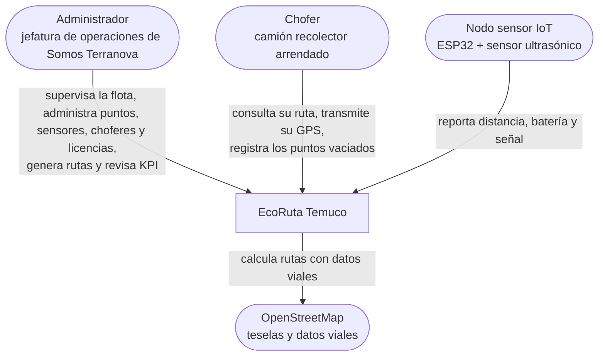
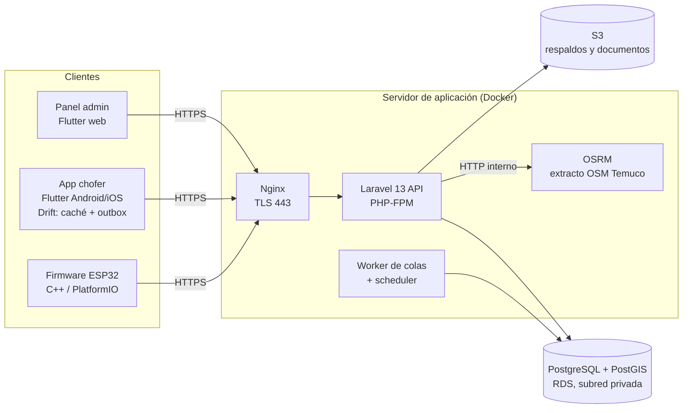
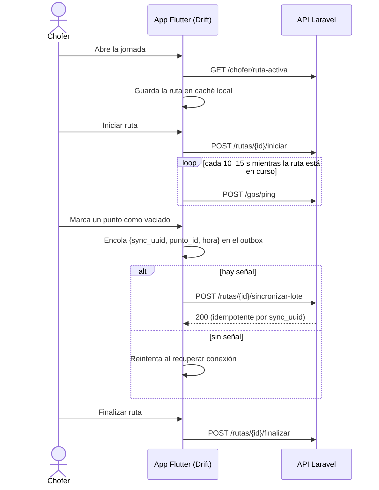
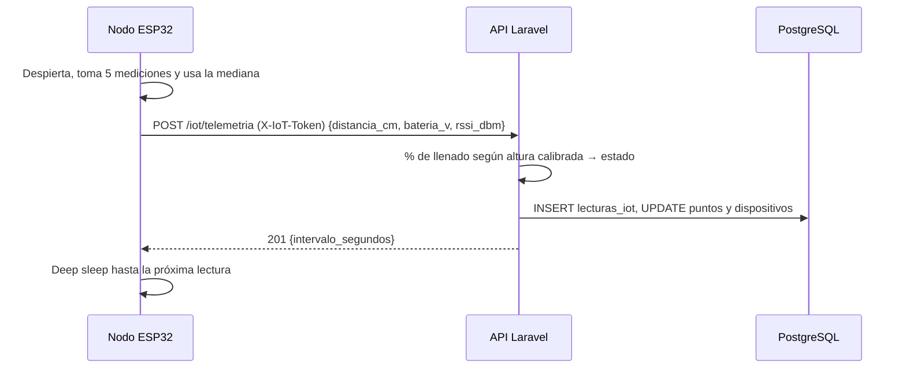

# Arquitectura — EcoRuta Temuco

Arquitectura vigente del sistema completo (API, clientes Flutter y nodo IoT), vista desde el back-end.
La versión del cliente está en `../logistica_camion_front_end/docs/ARCHITECTURE.md`.

> Los cambios respecto del diseño inicial están en la [sección 7](#7-cambios-respecto-del-diseño-inicial).

## 1. Contexto



**Actores:**

| Actor | Tipo | Responsabilidad |
|---|---|---|
| Administrador | Primario humano | Supervisar la flota en vivo, administrar puntos y sensores, despachar la ruta diaria y analizar los KPI. |
| Chofer | Primario humano | Ver su hoja de ruta, transmitir su ubicación desde el teléfono y registrar el vaciado de cada contenedor. |
| Nodo sensor IoT | Primario de sistema | Reportar de forma autónoma el nivel de llenado, la batería y la calidad de señal. |
| OpenStreetMap / OSRM | Secundario externo | Cartografía y cálculo del orden óptimo de paradas. Reemplaza a Google Maps Platform ([ADR-0005](ADR/0005-openstreetmap-y-osrm-en-lugar-de-google-maps.md)). |

## 2. Contenedores



| Contenedor | Tecnología | Estado |
|---|---|---|
| API REST | Laravel 13, PHP 8.5, Sanctum | 🟡 Parcial (auth, camiones, choferes) |
| Worker y scheduler | `queue:work`, `schedule:run` | ⏳ Pendiente (KPI periódicos, limpieza de GPS, alertas) |
| Base de datos | PostgreSQL 18 + PostGIS 3.6 (`postgis/postgis:18-3.6-alpine` en Sail y CI) / RDS + PostGIS | ✅ |
| Motor de ruteo | OSRM (`osrm/osrm-backend`) con extracto OSM recortado a Temuco–Padre Las Casas | ⏳ Pendiente (BE-10) |
| Panel admin y app chofer | Flutter (repo hermano) | 🟡 Parcial; vistas simuladas por reemplazar |
| Firmware del nodo | ESP32 DevKit + sensor ultrasónico, PlatformIO | ⏳ Pendiente (IOT-01) |

## 3. Componentes del back-end

| Módulo | Responsabilidad | Código | Estado | Tarea |
|---|---|---|---|---|
| Autenticación y roles | Login con token Sanctum, `me`, logout, middleware `role:` y `active`, limitación de intentos | `AuthController`, `EnsureUserHasRole`, `EnsureUserIsActive` | ✅ | — |
| Auditoría | Registro de login, logout, fallos y acciones críticas | `AuditLog::registrar` | ✅ (ampliar) | BE-02 |
| Flota | CRUD de camiones y choferes, asignación chofer ↔ camión | `CamionController`, `ChoferController` | ✅ | — |
| Licencias | Documento de licencia, vencimiento, verificación y regla clase ↔ camión | `app/Services/Licencias/` | ⏳ | BE-12 |
| Puntos y sectores | Puntos georreferenciados, sector y día de recolección, estado de llenado | `PuntoController`, `SectorController` | ⏳ | BE-03, BE-04 |
| Sensores IoT | Registro de kits, token por dispositivo, batería, heartbeat | `DispositivoController` | ⏳ | BE-05 |
| Ingesta IoT | `POST /iot/telemetria`, cálculo de porcentaje y estado | `app/Services/Iot/ProcesadorDeTelemetria` | ⏳ | BE-06 |
| GPS | Ping del teléfono, flota en vivo, traza histórica | `GpsController` | ⏳ | BE-07 |
| Administración de GPS | Estado de cada teléfono rastreador: último ping, precisión, batería, permisos | `DispositivoMovilController` | ⏳ | BE-08 |
| Comunicaciones | Peticiones y bytes por dispositivo y día, señal, estimación mensual | middleware `RegistrarConsumo` | ⏳ | BE-09 |
| Motor de rutas | Filtrar puntos listos, ordenar con OSRM y caer a proximidad PostGIS si falla | `app/Services/Rutas/` | ⏳ | BE-10 |
| Ejecución de ruta | Ruta activa del chofer, iniciar, recolectar, sincronizar lote, finalizar | `RutaChoferController` | ⏳ | BE-11 |
| KPI | Métricas base y KPI con meta, alertas y exportación PDF/CSV | `app/Services/Kpi/` | ⏳ | BE-13, BE-14 |

## 4. Flujos principales

### 4.1 Generación de la ruta diaria

```mermaid
sequenceDiagram
    actor A as Administrador
    participant API as API Laravel
    participant DB as PostgreSQL/PostGIS
    participant R as OSRM
    A->>API: POST /rutas/generar {camion_id, chofer_id, fecha_programada}
    API->>API: Valida licencia vigente y verificada del chofer (BE-12)
    API->>DB: Puntos activos de los sectores del día (más de 100 por día)
    API->>API: Incluye alto/lleno vigentes y desconocidos (calendario, ADR-0013); excluye vigentes vacío/bajo/medio
    API->>R: /trip (planta → puntos listos → planta)
    alt OSRM responde
        R-->>API: orden óptimo, duración y distancia por tramo, geometría
    else falla o timeout
        API->>DB: orden por vecino más cercano (ST_Distance)
        Note over API: modo_calculo = "proximidad"
    end
    API->>DB: INSERT rutas + ruta_puntos (horas estimadas)
    API-->>A: 201 {data: ruta}
```

### 4.2 Ejecución en terreno con conectividad intermitente



### 4.3 Lectura de un sensor



## 5. Despliegue

| Entorno | Infraestructura | Uso |
|---|---|---|
| Local | Laravel Sail (`compose.yaml`): `laravel.test` + `pgsql`, más el servicio `osrm` (BE-10) | Desarrollo y pruebas |
| Staging | Servidor accesible por HTTPS desde internet: AWS EC2 + Docker; RDS o PostgreSQL en el mismo host durante el piloto (BE-16) | Pruebas en terreno con teléfonos reales y nodos ESP32. **Necesario para la demo final** |
| Producción | Objetivo: EC2 `t3.medium` (2 vCPU, 4 GiB) + RDS PostgreSQL/PostGIS en subred privada + S3 + Route 53 + CloudWatch/SNS; CI/CD con GitHub Actions | Operación |

**Por qué un servidor público antes de la demo final:** los teléfonos de los choferes y los ESP32 envían datos desde la calle. Con `localhost` no hay datos reales que mostrar.

**OSRM en 4 GiB de RAM:** se preprocesa solo un recorte del extracto de Chile (Geofabrik) con la caja de Temuco–Padre Las Casas (`osmium extract --bbox`). Así el preprocesamiento y el consumo de memoria quedan acotados.

## 6. Atributos de calidad y cómo se cumplen

| Atributo (SLA) | Mecanismo |
|---|---|
| Posición GPS ≤ 30 s | Ping cada 10–15 s; el panel consulta `/gps/flota` cada 10–15 s; la última posición se guarda en `camiones` (sin JOIN sobre el histórico). |
| Estado de un punto ≤ 5 min | Nodo con período ≤ 5 min (configurable desde la respuesta de la API) y buffer con reintentos. |
| Ruta ≤ 2 min | OSRM local (sub-segundo para decenas de puntos), timeout de 20 s y modo degradado por proximidad. |
| P95 ≤ 800 ms | Índices por estado y fecha, respuestas paginadas y caché del tablero de KPI. Se verifica con k6 (BE-17). |
| Cero pérdida de registros offline | Outbox en Drift, `sync_uuid` único y sincronización por lotes. |
| Disponibilidad 95 % | Health check en `/` (o `/up`), reinicio automático de contenedores y respaldos con PITR. |

## 7. Cambios respecto del diseño inicial

Actualizar los diagramas con estos cambios es la tarea DOC-02.

| Tema | Diseño inicial | Vigente | Motivo |
|---|---|---|---|
| Mapas y ruteo | Google Maps Platform (Routes/Directions) | OpenStreetMap + OSRM autoalojado; modo degradado PostGIS | Gratuito y sin cuota ([ADR-0005](ADR/0005-openstreetmap-y-osrm-en-lugar-de-google-maps.md)) |
| Conectividad del sensor | Wi-Fi 802.11 b/g/n (también se consideró LoRaWAN) | Wi-Fi en el piloto; LTE-M o NB-IoT como escalamiento; LoRaWAN solo con gateway justificado | Hay que justificar alcance, gateway, permisos y costos ([ADR-0007](ADR/0007-conectividad-del-nodo-iot.md)) |
| KPI | Seis métricas (tiempos promedio, conteos y ranking) | Seis KPI de resultado contra meta; las métricas quedan como base de cálculo | Un promedio o un conteo es una métrica, no un KPI ([ADR-0009](ADR/0009-kpi-como-resultado-contra-meta.md)) |
| Choferes | Clase de licencia como texto libre | Documento de licencia, vencimiento, verificación y regla clase ↔ camión | La clase declarada no tenía respaldo verificable ([ADR-0010](ADR/0010-validacion-documental-de-licencias.md)) |
| Secciones del panel | Flota, puntos, rutas y KPI | Además: kits de sensores, administración de GPS y comunicaciones | Secciones necesarias para operar sensores, GPS y comunicaciones |
| Nombres de tablas | `usuarios`, `puntos_reciclaje`, `paradas_ruta`, `telemetria_gps`, `lecturas_sensor_iot` | `users`, `puntos`, `ruta_puntos`, `ubicaciones_gps`, `lecturas_iot` | Convención de Laravel; equivalencias en [DATA_MODEL.md](DATA_MODEL.md) |
| Coordenadas | `GEOMETRY(Point/LineString, 4326)` | `decimal(10,7)` en `camiones`; PostGIS habilitado para las columnas geográficas nuevas (BE-01, BE-03) | Los clientes reciben latitud y longitud decimales |
| Panel web | "Aplicación web" sin tecnología explícita | Flutter web (misma base de código que la app) | [ADR-0002 del front-end](../../logistica_camion_front_end/docs/ADR/0002-flutter-base-unica-web-y-movil.md) |
