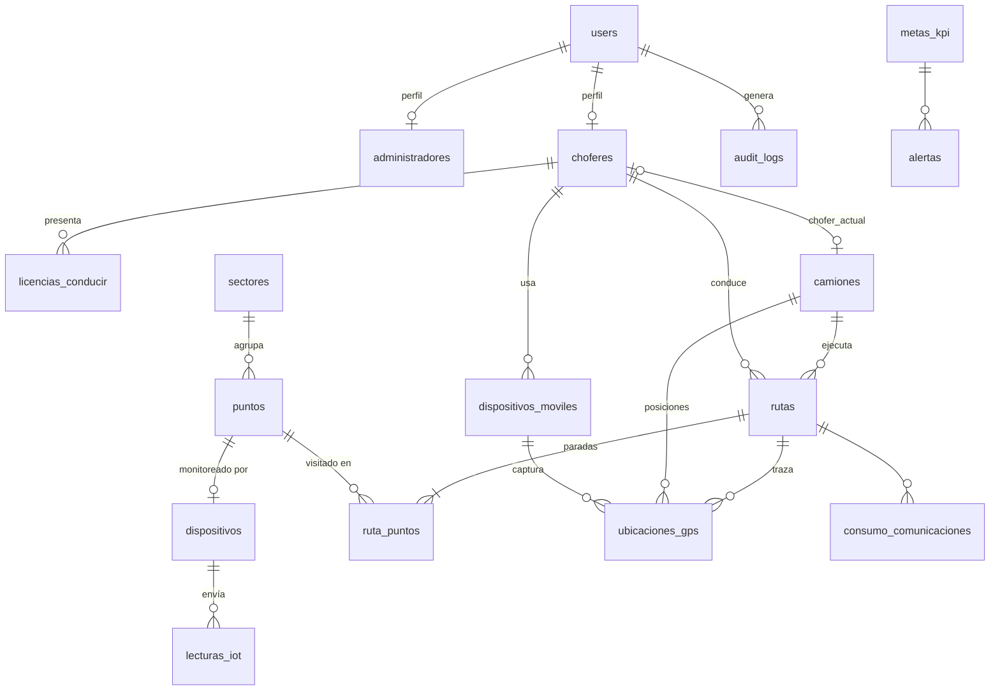

# Modelo de datos — EcoRuta Temuco

Base de datos relacional en **PostgreSQL** con la extensión **PostGIS** (pendiente de habilitar, BE-01), normalizada en 3FN.
Las tablas ✅ existen en `database/migrations/`. Las ⏳ son el diseño objetivo que deben implementar las tareas indicadas.

## 1. Convenciones

- Nombres en español, snake_case, tablas en plural (`camiones`, `ruta_puntos`). Claves primarias `id` (`bigIncrements`) y foráneas `<entidad>_id`.
- Fechas y horas en UTC. Las columnas nuevas usan `timestampTz` (las existentes usan `timestamp`).
- Coordenadas WGS84 con `decimal(10,7)` (`latitud`, `longitud`). Cuando PostGIS esté habilitado, se agrega una columna `ubicacion geography(Point, 4326)` con índice GiST en `puntos` (BE-01, BE-03).
- Enumeraciones con `string` + validación en PHP (enum de PHP en `app/Enums/`) para no depender de tipos `ENUM` difíciles de migrar. Las tablas existentes usan `enum()` de Laravel; se mantiene así.
- Bajas lógicas con `activo`/`is_active`, nunca `DELETE` físico de datos operativos.
- Datos personales cifrados con el cast `encrypted` (AES-256 con `APP_KEY`); identificadores sensibles como HMAC-SHA256.

## 2. Diagrama entidad-relación (objetivo)

## 3. Equivalencia con el diseño inicial

| Diseño inicial | Implementación | Comentario |
|---|---|---|
| `usuarios` (rol `admin`/`chofer`, `nombre_cifrado`) | `users` + `administradores` + `choferes` | Perfil separado por rol; el nombre cifrado vive en `choferes` |
| `camiones` | `camiones` | Además guarda la última posición GPS (sin JOIN para el mapa) |
| `puntos_reciclaje` (`nombre_sector`, `ubicacion_geom`) | `puntos` + `sectores` | El sector pasa a tabla propia con sus días de recolección |
| `rutas` (`trazado_geom`, `modo_calculo`) | `rutas` | `encoded_polyline` (texto) en lugar de `LineString`; `modo_calculo` = `osrm` o `proximidad` |
| `paradas_ruta` (`uuid_sincronizacion`) | `ruta_puntos` (`sync_uuid`) | Mismo propósito: idempotencia offline |
| `telemetria_gps` | `ubicaciones_gps` | Agrega `camion_id`, `precision_m` y `dispositivo_movil_id` |
| `lecturas_sensor_iot` (`mac_esp32`) | `dispositivos` + `lecturas_iot` | El dispositivo pasa a ser una entidad administrable (kits de sensores) |
| — | `licencias_conducir`, `dispositivos_moviles`, `consumo_comunicaciones`, `metas_kpi`, `alertas` | Nuevas en el diseño vigente |

## 4. Tablas implementadas ✅

### `users`
`id`, `name`, `email` (único), `email_verified_at`, `password` (bcrypt), `remember_token`, `role` (`administrador` \| `chofer` \| `sysadmin`, índice, por defecto `chofer`), `is_active` (bool), columnas de 2FA de Fortify (`two_factor_*`), timestamps.

### `administradores`
`id`, `user_id` (único → `users`, cascade), `nombre_completo` (text), `cargo`, `telefono`, timestamps.

### `choferes`
`id`, `user_id` (único → `users`, cascade), `nombre_cifrado` (text, `encrypted`), `rut_hash` (único, HMAC-SHA256 del RUT normalizado con `APP_KEY`), `licencia_clase` (por defecto `A4`), `telefono_cifrado` (`encrypted`), `disponible` (bool), timestamps.
> Con BE-12, `licencia_clase` pasa a reflejar la licencia **verificada** vigente (copia desnormalizada de `licencias_conducir`).

### `camiones`
`id`, `patente` (único, 10), `marca`, `modelo`, `anio`, `capacidad_kg` (decimal 8,2), `estado_operativo` (`disponible` \| `en_ruta` \| `mantenimiento` \| `inactivo`, índice), `chofer_actual_id` (→ `choferes`, nullOnDelete, único por regla de validación), `ultima_latitud`, `ultima_longitud` (decimal 10,7), `velocidad_actual_kmh` (decimal 5,2), `ultima_actualizacion_gps`, timestamps.
> BE-12 agrega `peso_bruto_vehicular_kg` (decimal 8,2) para validar la clase de licencia requerida.

### `audit_logs`
`id`, `user_id` (nullable), `accion` (`login`, `logout`, `failed_login`; BE-02 agrega `camion_desactivado`, `chofer_desactivado`, `licencia_verificada`, `ruta_generada`, `token_iot_rotado`), `ip_address`, `user_agent`, `detalles` (jsonb, **sin datos personales**), `created_at`. Índice `(user_id, created_at)`.

### Tablas del framework
`personal_access_tokens` (Sanctum; `name` = `device_name`), `password_reset_tokens`, `sessions`, `cache`, `jobs`, `passkeys` (Fortify, sin uso en la API; evaluar en BE-02).

> ⚠️ `2026_10_28_165602_puntos.php` y `2026_10_28_165616_dispositivo.php` existen pero tienen `up()` vacío. BE-03 y BE-05 deben **eliminarlas y crear migraciones nuevas** (`create_puntos_table`, …) y luego ejecutar `migrate:fresh --seed` en los entornos locales. No hay producción todavía.

## 5. Tablas pendientes ⏳

### `sectores` (BE-03)
| Columna | Tipo | Notas |
|---|---|---|
| `id` | bigint PK | |
| `nombre` | string(150), único | Nombre del sector que usa Somos Terranova |
| `dias_recoleccion` | jsonb | Arreglo ISO 1–7 (1 = lunes). Ej. `[2, 4]` = martes y jueves |
| `periodicidad_semanal` | smallint | Visitas por semana declaradas (1–3). Si no coincide con los días, mandan los días |
| `puntos_esperados` | smallint null | Número de puntos que debería tener el sector (sirve para conciliar la importación) |
| `descripcion` | text null | |
| `activo` | bool | |

### `puntos` (BE-03, BE-04)
| Columna | Tipo | Notas |
|---|---|---|
| `id` | bigint PK | |
| `sector_id` | FK → `sectores` | restrictOnDelete |
| `nombre` | string | Ej. "Condominio Los Pablos" |
| `direccion` | string | |
| `tipo_punto` | string | `condominio`, `punto_calle`, `empresa`, `municipio` |
| `tipo_material` | string null | `plastico`, `vidrio`, `carton`, `mixto` (confirmar con la empresa) |
| `latitud`, `longitud` | decimal(10,7) | Validar dentro de la caja de Temuco–Padre Las Casas |
| `ubicacion` | geography(Point,4326) | Con PostGIS; índice GiST |
| `estado_llenado` | string null | `vacio`, `bajo`, `medio`, `alto`, `lleno`; `null` = nunca medido |
| `porcentaje_llenado` | smallint 0–100 null | |
| `origen_estado` | string null | `sensor`, `manual`, `observacion`, `recoleccion` |
| `ultima_actualizacion_estado` | timestampTz null | |
| `estado_vigente_hasta` | timestampTz null | Después de esta fecha el estado se trata como desconocido y el punto entra por calendario ([ADR-0013](ADR/0013-estado-de-puntos-sin-sensor.md)) |
| `fuente_ubicacion` | string | `coordenadas`, `geocodificada`, `manual` (cómo se obtuvo la coordenada al importar) |
| `requiere_revision` | bool | Coordenada dudosa, punto dado de baja en terreno o fuera de la zona |
| `nota` | text null | Nota libre del archivo de importación |
| `codigo_externo` | string null, único | Identificador estable de la fila en el archivo de importación (importación idempotente, BE-04) |
| `activo` | bool | |
Índices: `(activo, estado_llenado)`, `sector_id`.

### `dispositivos` — kits de sensores (BE-05)
| Columna | Tipo | Notas |
|---|---|---|
| `id` | bigint PK | |
| `punto_id` | FK → `puntos`, único, null | Un sensor por punto en el piloto |
| `codigo_hardware` | string único | MAC del ESP32 |
| `token_hash` | string(64) único | SHA-256 del token; el token en claro no se guarda |
| `tipo_sensor` | string | `ultrasonico_hcsr04`, `ultrasonico_jsn_sr04t` |
| `conectividad` | string | `wifi`, `lte_m`, `nb_iot`, `lorawan` (ADR-0007) |
| `altura_contenedor_cm` | smallint | Distancia del sensor al fondo con el contenedor vacío |
| `distancia_sensor_lleno_cm` | smallint | Distancia mínima útil (zona ciega del sensor, ~20–25 cm según el modelo) |
| `intervalo_lectura_seg` | int | Se devuelve al nodo en cada respuesta |
| `firmware_version` | string null | |
| `bateria_voltaje` | decimal(4,2) null | Última lectura |
| `rssi_dbm` | smallint null | Última lectura |
| `ultimo_reporte_en` | timestampTz null | |
| `estado` | string | `activo`, `sin_reporte`, `bateria_baja`, `falla`, `inactivo` |
| `instalado_en` | date null | |
| `foto_instalacion_path` | string null | Disco privado; evidencia de cómo se mide |
| `notas` | text null | |

### `lecturas_iot` (BE-06)
`id`, `dispositivo_id` (FK cascade), `punto_id` (FK), `distancia_cm` (decimal 6,2), `porcentaje_calculado` (smallint), `estado_resultante`, `bateria_voltaje` (decimal 4,2 null), `rssi_dbm` (smallint null), `bytes_payload` (int null), `medido_en` (timestampTz, hora del nodo), `recibido_en` (timestampTz, hora del servidor). Índice `(punto_id, medido_en)`.

### `rutas` (BE-10)
`id`, `camion_id` (FK restrict), `chofer_id` (FK restrict), `creada_por_user_id` (FK null), `fecha_programada` (date), `estado` (`planificada`, `en_curso`, `completada`, `cancelada`), `modo_calculo` (`osrm`, `proximidad`), `total_puntos_evaluados`, `puntos_incluidos_count`, `puntos_excluidos_count` (smallint), `distancia_estimada_km` (decimal 6,2), `duracion_estimada_min` (smallint), `encoded_polyline` (text), `hora_inicio_real`, `hora_termino_real` (timestampTz null), `motivo_cancelacion` (text null), timestamps.
Índices: `(fecha_programada, estado)`, `chofer_id`, `camion_id`. Restricción: una ruta no cancelada por camión y fecha.

### `ruta_puntos` — paradas (BE-10, BE-11)
`id`, `ruta_id` (FK cascade), `punto_id` (FK restrict), `orden_parada` (smallint), `estado_llenado_inicial` (null si era desconocido), `motivo_inclusion` (`sensor`, `manual`, `observacion`, `calendario`), `estado_parada` (`pendiente`, `recolectado`, `omitido`), `hora_estimada_llegada` (timestampTz), `duracion_estimada_tramo_seg` (int), `hora_real_recoleccion` (timestampTz null, hora del teléfono), `nivel_observado` (string null), `sync_uuid` (uuid único null), `sincronizado_offline` (bool), `observaciones` (text null), timestamps.
Índices únicos: `sync_uuid`, `(ruta_id, orden_parada)`.

### `dispositivos_moviles` — teléfonos rastreadores (BE-08)
`id`, `chofer_id` (FK), `identificador_instalacion` (uuid único, header `X-Device-Id`), `plataforma` (`android`, `ios`, `web`), `modelo` (null), `version_app`, `permiso_ubicacion` (`siempre`, `en_uso`, `denegado`, `desconocido`), `ultimo_ping_en`, `ultima_precision_m`, `ultima_bateria_porcentaje`, `activo`, timestamps.

### `ubicaciones_gps` (BE-07)
`id`, `camion_id` (FK cascade), `ruta_id` (FK cascade), `chofer_id` (FK null), `dispositivo_movil_id` (FK null), `latitud`, `longitud` (decimal 10,7), `velocidad_kmh` (decimal 5,2 null), `rumbo_grados` (smallint null), `precision_m` (decimal 6,2 null), `capturado_en` (timestampTz), `recibido_en` (timestampTz).
Índices: `(camion_id, capturado_en desc)`, `(ruta_id, capturado_en)`. Retención: `GPS_RETENCION_DIAS` (BE-18).

### `consumo_comunicaciones` (BE-09)
`id`, `fecha` (date), `origen_tipo` (`dispositivo_iot`, `dispositivo_movil`), `origen_id`, `peticiones` (int), `bytes_entrada` (bigint), `bytes_salida` (bigint), `errores` (int), `rssi_suma`, `rssi_muestras` (para el promedio). Único `(fecha, origen_tipo, origen_id)`; se actualiza con *upsert* incremental.

### `licencias_conducir` (BE-12)
`id`, `chofer_id` (FK cascade), `clase`, `numero` (string null, `encrypted`), `fecha_ultimo_control` (date), `fecha_proximo_control` (date), `municipalidad`, `documento_path` (disco privado), `certificado_hoja_vida_path` (null), `estado` (`pendiente`, `verificada`, `rechazada`, `vencida`), `verificada_por_user_id` (FK null), `verificada_en` (timestampTz null), `observacion` (text null), `vigente` (bool: la última presentada), timestamps.

### `metas_kpi` y `alertas` (BE-13, BE-14)
- `metas_kpi`: `kpi_id` (`KPI-01` … `KPI-06`, único), `meta` (decimal 6,2), `comparador` (`>=`, `<=`), `tolerancia` (decimal null, p. ej. 15 % o 15 min), `actualizada_por_user_id`, timestamps. El seeder carga las metas iniciales del ADR-0009.
- `alertas`: `id`, `tipo` (`kpi_bajo_meta`, `tramo_anomalo`, `sensor_sin_reporte`, `bateria_baja`, `licencia_por_vencer`, `gps_sin_senal`), `prioridad`, `titulo`, `detalle` (jsonb), `kpi_id` null, `ruta_id` null, `dispositivo_id` null, `resuelta_en` null, timestamps.

## 6. Estados y transiciones

| Entidad | Estados | Transiciones |
|---|---|---|
| Punto (`estado_llenado`) | desconocido · vacio → bajo → medio → alto → lleno | Por porcentaje (umbrales 10/40/70/89); la recolección lo devuelve a `vacio` con 0 %; al pasar `estado_vigente_hasta` vuelve a contar como desconocido (ADR-0013) |
| Camión | disponible ⇄ en_ruta; disponible ⇄ mantenimiento; * → inactivo | `en_ruta` solo por iniciar/finalizar ruta |
| Ruta | planificada → en_curso → completada; planificada → cancelada | Iniciar y finalizar las hace el chofer; cancelar, el administrador |
| Parada | pendiente → recolectado; pendiente → omitido (al finalizar) | Idempotente por `sync_uuid` |
| Dispositivo IoT | activo ⇄ sin_reporte / bateria_baja; * → falla / inactivo | `sin_reporte` lo calcula el scheduler con `IOT_MINUTOS_SIN_REPORTE` |
| Licencia | pendiente → verificada / rechazada; verificada → vencida | `vencida` la marca el scheduler al pasar `fecha_proximo_control` |
