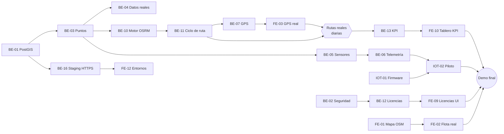

# Índice general de tareas — EcoRuta Temuco

Este es el **índice maestro** de todo lo que falta para que el sistema funcione completo y con datos reales. Cubre ambos repositorios:

| Prefijo | Dónde vive la tarea | Qué cubre |
|---|---|---|
| `BE-` | este repo, `tasks/` | API Laravel, base de datos, despliegue |
| `IOT-` | este repo, `tasks/` (el código va en `iot-esp32/`) | Firmware ESP32 e instalación del piloto |
| `DOC-` | este repo, `tasks/` | Diagramas, ficha técnica y costos, guion de la demo |
| `FE-` | `../logistica_camion_front_end/tasks/` | App Flutter (panel web y app del chofer) |

El plan de tareas anterior quedó archivado en [`_archivo/plan-original-tareas.md`](_archivo/plan-original-tareas.md). Este índice lo reemplaza.

## Cómo usar este índice (personas y agentes)

1. Elige una tarea `Pendiente` cuyas dependencias estén `Hecha`, empezando por prioridad **P0**.
2. Pásale al agente la ficha: *"Ejecuta `tasks/BE-03-sectores-y-puntos-de-reciclaje.md` siguiendo AGENTS.md"*.
3. Al empezar, cambia el estado a `En progreso` aquí y en la ficha. Al terminar, márcala `Hecha` solo si se cumplen todos los criterios de aceptación.
4. Las tareas FE dependen del contrato de `docs/API.md`; si una tarea BE cambia el contrato, avísalo en la tarea FE relacionada.

**Estados:** `Pendiente` · `En progreso` · `Bloqueada` (indicar por qué) · `Hecha`.
**Prioridad:** **P0** = necesario para la demo final (datos reales y secciones faltantes) · **P1** = calidad, pruebas y cumplimiento · **P2** = mejora posterior.
**Responsable:** sugerido según la división original (Maximiliano: rutas, GPS, chofer, IoT · Nelson: seguridad, mantenedores, KPI, portal admin). Ajústenlo libremente para repartir el trabajo de forma equilibrada.

## Tablero

### Back-end, IoT y documentación (este repo)

| ID | Tarea | Prio | Depende de | Resp. | Sprint | Estado |
|---|---|---|---|---|---|---|
| [BE-01](BE-01-postgis-y-ci.md) | PostgreSQL + PostGIS en Sail y en CI | P0 | — | Maximiliano | A | Pendiente |
| [BE-02](BE-02-endurecimiento-de-seguridad.md) | Endurecimiento: registro público, tokens, auditoría de bajas | P0 | — | Nelson | A | Pendiente |
| [BE-16](BE-16-staging-https.md) | Servidor de staging accesible por HTTPS | P0 | BE-01 | Maximiliano | A | Pendiente |
| [BE-03](BE-03-sectores-y-puntos-de-reciclaje.md) | Sectores y puntos de reciclaje (modelo + API) | P0 | BE-01 | Nelson | A | Pendiente |
| [BE-04](BE-04-importacion-de-puntos-reales.md) | Importar los sectores y puntos reales desde CSV | P0 | BE-03, CSV con los datos reales | Nelson | A | Pendiente |
| [BE-12](BE-12-licencias-de-conducir.md) | Licencias de conducir: documentos, verificación y reglas | P0 | BE-02 | Nelson | A | Pendiente |
| [BE-10](BE-10-motor-de-rutas-osrm.md) | Esquema de rutas y motor OSRM con modo degradado | P0 | BE-03 | Maximiliano | A | Pendiente |
| [BE-11](BE-11-ciclo-de-vida-de-la-ruta.md) | Ciclo de vida de la ruta del chofer (offline idempotente) | P0 | BE-10 | Maximiliano | B | Pendiente |
| [BE-07](BE-07-rastreo-gps.md) | Rastreo GPS: ping, flota en vivo y traza | P0 | BE-11 | Maximiliano | B | Pendiente |
| [BE-08](BE-08-administracion-de-gps.md) | Administración de GPS (teléfonos rastreadores) | P0 | BE-07 | Maximiliano | B | Pendiente |
| [BE-05](BE-05-kits-de-sensores-iot.md) | Kits de sensores IoT: registro, token y estado | P0 | BE-03 | Nelson | B | Pendiente |
| [BE-06](BE-06-telemetria-iot.md) | Ingesta de telemetría IoT y cálculo de llenado | P0 | BE-05 | Nelson | B | Pendiente |
| [BE-09](BE-09-comunicaciones-y-consumo-de-datos.md) | Comunicaciones: consumo de datos y calidad de enlace | P0 | BE-06, BE-07 | Nelson | B | Pendiente |
| [BE-13](BE-13-kpi-con-metas.md) | KPI con metas (tablero) | P0 | BE-11 | Nelson | C | Pendiente |
| [BE-14](BE-14-alertas-y-exportacion-kpi.md) | Alertas y exportación de reportes | P0 | BE-13 | Nelson | C | Pendiente |
| [BE-15](BE-15-datos-y-cuentas-de-demo.md) | Cuentas y datos de demostración | P0 | BE-04, BE-12, BE-16 | Nelson | C | Pendiente |
| [IOT-01](IOT-01-firmware-nodo-sensor.md) | Firmware ESP32 del nodo sensor | P0 | BE-06 (contrato) | Maximiliano | A–B | Pendiente |
| [IOT-02](IOT-02-instalacion-y-calibracion.md) | Instalación, calibración y prueba en terreno | P0 | IOT-01, BE-06, BE-16 | Maximiliano | B | Pendiente |
| [DOC-01](DOC-01-ficha-tecnica-y-costos.md) | Ficha técnica y costos (sensor, batería, comunicaciones, servidor) | P0 | — | Maximiliano | A–B | Pendiente |
| [DOC-02](DOC-02-actualizar-diagramas.md) | Actualizar los diagramas a la arquitectura vigente | P0 | ADR propuestos aceptados | Ambos | C | Pendiente |
| [DOC-03](DOC-03-guion-de-demo.md) | Guion de la demo final, preguntas probables y ensayos | P0 | BE-15 | Ambos | C | Pendiente |
| [BE-17](BE-17-pruebas-de-rendimiento-y-seguridad.md) | Pruebas de rendimiento (k6) y seguridad (ZAP, audit) | P1 | BE-16 | Nelson | C | Pendiente |
| [BE-18](BE-18-retencion-de-datos-gps.md) | Retención y privacidad de la traza GPS (Ley 21.719) | P1 | BE-07 | Maximiliano | C | Pendiente |
| [BE-19](BE-19-especificacion-openapi.md) | Especificación OpenAPI de la API | P2 | — | — | — | Pendiente |

### Front-end Flutter (`../logistica_camion_front_end/tasks/`)

| ID | Tarea | Prio | Depende de | Resp. | Sprint | Estado |
|---|---|---|---|---|---|---|
| FE-12 | Configuración por entorno y builds de demo | P0 | BE-16 | Maximiliano | A | Pendiente |
| FE-01 | Mapa real con OpenStreetMap (`flutter_map`) | P0 | — | Maximiliano | A | Pendiente |
| FE-05 | Mantenedor de puntos de reciclaje y sectores | P0 | BE-03, FE-01 | Nelson | A | Pendiente |
| FE-09 | Licencias en la sección Choferes | P0 | BE-12 | Nelson | A | Pendiente |
| FE-11 | Generador de rutas sobre puntos reales con mapa | P0 | BE-10, FE-01 | Maximiliano | B | Pendiente |
| FE-04 | Eliminar los datos de ejemplo (rutas y KPI) | P0 | BE-10, BE-13 | Nelson | B–C | Pendiente |
| FE-03 | Transmisión GPS real desde el teléfono del chofer | P0 | BE-07, BE-11 | Maximiliano | B | Pendiente |
| FE-02 | Flota en vivo con datos reales | P0 | BE-07, BE-03, FE-01 | Maximiliano | B | Pendiente |
| FE-06 | Mantenedor de kits de sensores | P0 | BE-05, BE-06 | Nelson | B | Pendiente |
| FE-07 | Sección Administración de GPS | P0 | BE-08 | Nelson | B | Pendiente |
| FE-08 | Sección Comunicaciones (ancho de banda) | P0 | BE-09 | Nelson | B | Pendiente |
| FE-10 | Tablero de KPI con metas | P0 | BE-13, BE-14 | Nelson | C | Pendiente |
| FE-13 | Pruebas de integración y regresión sin datos simulados | P1 | FE-02, FE-04 | Nelson | C | Pendiente |

## Camino crítico hasta la demo final



Las rutas reales deben ejecutarse **varios días antes de la demo final** para que los KPI tengan datos (ver [ROADMAP](../docs/ROADMAP.md)).

## Trabajo ya terminado (referencia)

- **Back-end:** migraciones y modelos de `users` (rol, activo), `administradores`, `choferes` (cifrado), `camiones`, `audit_logs`; login, logout y `me` con Sanctum; middleware de rol y de cuenta activa; CRUD de camiones y choferes; seeder de ejemplo.
- **Front-end:** login con redirección por rol; shell responsivo con tema y zoom; mantenedores de camiones y choferes conectados a la API; base Drift con ruta en caché y outbox de recolecciones; vistas del chofer; vistas de rutas, KPI y flota (**con datos simulados o de ejemplo**, que reemplazan FE-02, FE-03 y FE-04).

## Plantilla de ficha de tarea

```markdown
# XX-NN · Título en infinitivo

| Campo | Valor |
|---|---|
| Estado | Pendiente |
| Prioridad | P0 |
| Responsable sugerido | … |
| Depende de | … |
| Origen | Motivo de la tarea, documentos de `docs/`, ADR-xxxx |

## Objetivo
Una o dos frases con el resultado observable.

## Contexto
Lo mínimo para entender por qué y qué existe hoy.

## Alcance
- Incluye: …
- No incluye: …

## Pasos sugeridos
1. …

## Criterios de aceptación
- [ ] Verificable por una prueba o por una revisión manual concreta.

## Pruebas
Qué pruebas automatizadas agregar y qué revisar a mano.

## Archivos probables
Rutas a crear o modificar.
```
